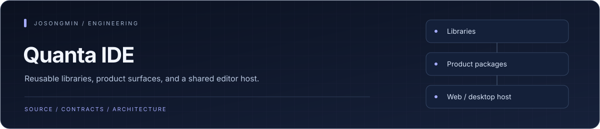
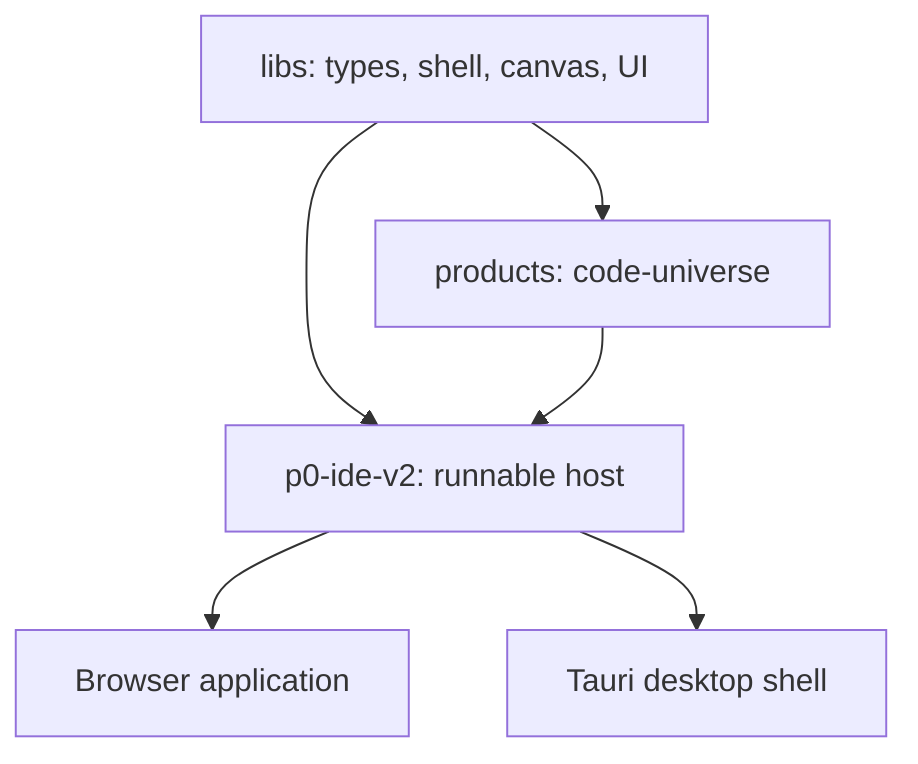

<p align="center"></p>

# Quanta IDE

A modular IDE workspace that assembles shared libraries and mountable product interfaces into a Vite, React, and TypeScript shell. An optional Tauri application provides the desktop host.


## Engineering highlights

| Mechanism | Engineering purpose |
| :--- | :--- |
| **Three-tier workspace** | Reusable libraries, independently composed product packages, and the runnable editor host have different dependency roles. |
| **Canvas specialization** | Canvas engine, Pixi rendering, and worker packages separate graph/layout work from rendering and host integration. |
| **Software-intelligence surfaces** | Editor overlays and inspectors present engine-shaped signals through typed state and product contracts. |
| **Platform boundary** | The browser host and Tauri shell share UI-facing libraries while native commands remain in the desktop boundary. |


## Architecture at a glance



## What it does

- Share domain types, canvas infrastructure, and UI primitives through `libs/*`.
- Mount product interfaces from `products/*` without coupling products to one another.
- Run the web shell in `p0-ide-v2` or develop the desktop host separately.
- Check workspace types, catalog consistency, lint rules, unit tests, and browser flows.

## Repository map

| Path | Responsibility |
| --- | --- |
| [libs](libs) | Shared libraries. |
| [products](products) | Mountable product interfaces. |
| [p0-ide-v2](p0-ide-v2) | Runnable web application. |
| [desktop](desktop) | Optional Tauri desktop host. |
| [demo-corpus](demo-corpus) | Development and demonstration repositories. |
| [docs](docs) | Architecture, handoffs, and roadmap. |

## Run locally

Use Node.js >=20.0.0 and pnpm@10.33.0. Run these commands from the repository root.

```sh
pnpm install --frozen-lockfile
pnpm dev
```

## Development checks

```sh
pnpm typecheck
pnpm lint
pnpm test
pnpm build
```

The web application is served at [http://localhost:5174/ide/](http://localhost:5174/ide/). The `/ide/` base path and strict port are configured in `p0-ide-v2/vite.config.ts`.

```sh
pnpm validate
pnpm e2e
```

## Scope and status

The repository combines reusable infrastructure and product UI. Demo policies and code samples do not establish live analysis, authentication, or service integration. Web verification does not qualify the desktop package.

## Documentation

- [Contributor conventions](.ai/AGENT.md)
- [Information architecture](docs/ia.md)
- [Architecture decisions](docs/adr)
- [Script reference](package.json)
